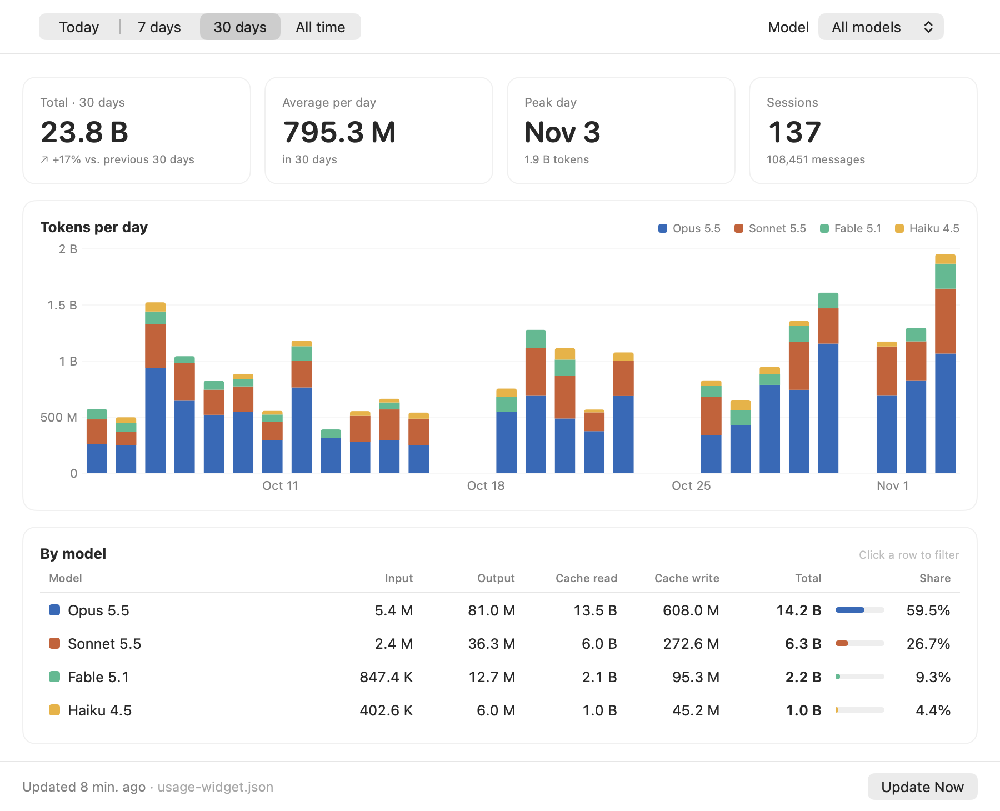
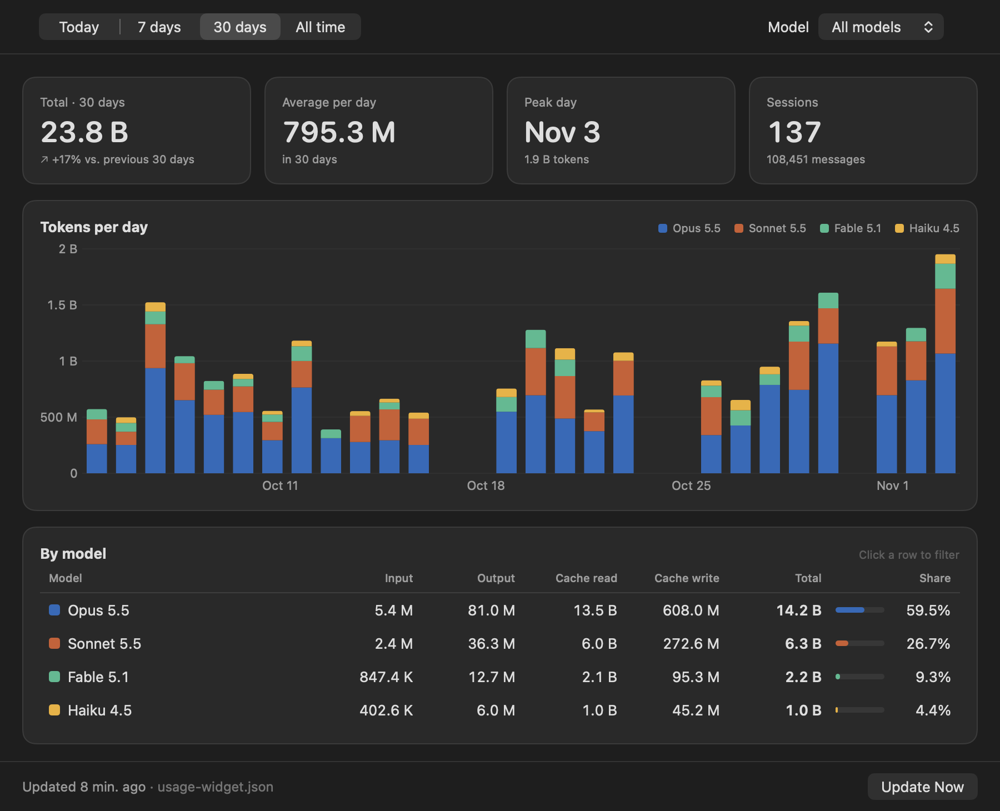
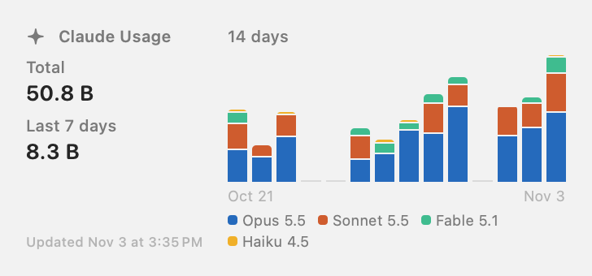
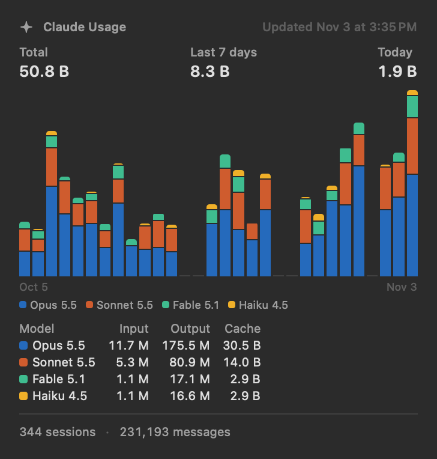

# ClaudeUsageWidget

A native macOS desktop widget and window that show how many tokens you have used in [Claude Code](https://www.anthropic.com/claude-code), broken down by model, by day and by token type.

> **Unofficial. Not affiliated with, endorsed by, or sponsored by Anthropic.** "Claude" is a trademark of Anthropic. This project contains no Anthropic or Claude logos. The app icon is original artwork generated with AI and is published under this repository's license.

| Window (light) | Window (dark) |
|---|---|
|  |  |

| Medium widget | Large widget |
|---|---|
|  |  |

The screenshots use synthetic demo data.

## Features

- Desktop widgets in three sizes: small (all-time total plus today), medium (14 days of stacked bars), large (30 days, input/output/cache per model family, sessions and messages).
- Pick one model or all models per widget (right-click the widget, then Edit Widget).
- A usage window with ranges Today / 7 days / 30 days / All time, a model filter, a summary with comparison to the previous period, a per-day chart and a per-model table.
- Exact model names (for example "Opus 5.5") and stable per-model colors.
- English and Spanish UI (String Catalog); numbers and dates follow your system locale.
- Everything is local. No network access, no account, no telemetry.

## Requirements

- macOS 14 (Sonoma) or later. Windows and Linux are not supported: the widget is built on WidgetKit and SwiftUI. Only `tools/update_usage.py` is portable (see below).
- Xcode 15 or later (the project is developed with a recent Xcode) to build it. Command Line Tools alone are not enough because the build needs the macOS SDK with WidgetKit.
- Python 3 at `/usr/bin/python3` (it ships with macOS; standard library only).
- Claude Code usage data in `~/.claude/projects`.

## Install

There is no prebuilt binary: you build it yourself and sign it ad hoc ("Sign to Run Locally").

```sh
git clone https://github.com/Duayti/ClaudeUsageWidget.git
cd ClaudeUsageWidget

# Optional: use your own bundle identifier prefix (default: com.example.ClaudeUsageWidget).
# Do this if you want a unique identity; see Troubleshooting. Regenerates the Xcode project.
# BUNDLE_PREFIX=com.yourname.ClaudeUsageWidget python3 tools/generate_project.py

xcodebuild -project ClaudeUsageWidget.xcodeproj -scheme ClaudeUsageWidget \
  -configuration Release -derivedDataPath build/DerivedData \
  CODE_SIGN_IDENTITY=- build

mkdir -p ~/Applications
ditto build/DerivedData/Build/Products/Release/ClaudeUsageWidget.app ~/Applications/ClaudeUsageWidget.app
open ~/Applications/ClaudeUsageWidget.app     # registers the widget and opens the window

# Keep the data fresh in the background (a LaunchAgent that runs every 12 hours):
tools/install_updater.sh
```

If you used a custom `BUNDLE_PREFIX`, export the same value when running `tools/install_updater.sh` so the LaunchAgent label matches.

Then right-click the desktop, choose **Edit Widgets**, search for **Claude Usage**, pick a size and drag it onto the desktop.

Building locally avoids Gatekeeper prompts, because a locally built app carries no quarantine flag. If the widget still does not load, open the project in Xcode and choose your personal team under Signing & Capabilities for both targets.

## How it works

1. `tools/update_usage.py` reads the session transcripts Claude Code keeps in `~/.claude/projects/**/*.jsonl` and writes a summary to `~/.claude/usage-widget.json` (same schema as Claude Code's own `stats-cache.json`, plus a per-day, per-model token breakdown). It is incremental: it stores its progress per file in `~/.claude/usage-widget-state.json` and only reads new data (first run is the slowest; later runs take about a second). Both files are written with mode 0600.
2. The widget extension is sandboxed. It reads only two files, through a read-only temporary-exception entitlement: `~/.claude/usage-widget.json` and `~/.claude/stats-cache.json`. It falls back to `stats-cache.json` if the first one is missing, broken, or more than 30 minutes older than the second. It cannot read anything else under `~/.claude`.
3. The host app is not sandboxed because it runs `/usr/bin/python3 -I` on the updater script (copied to `~/Library/Application Support/ClaudeUsageWidget/`, outside `~/Documents`, which launchd cannot read because of TCC). The app runs the updater once when it opens, and "Update Now" repeats it.
4. Widgets refresh every 12 hours and display the modification time of the file they read.

I chose a temporary-exception entitlement over an App Group because it needs no provisioning profile (macOS 15 and later require a team profile for App Groups), so ad hoc signing works. The downside is that the Mac App Store would not accept it.

### Updater options

```sh
/usr/bin/python3 -I tools/update_usage.py \
  [--claude-dir DIR]      # default ~/.claude
  [--projects-dir DIR]    # default <claude-dir>/projects
  [--output FILE]         # default <claude-dir>/usage-widget.json
  [--state FILE]          # default <output>-state.json
  [--full]                # ignore saved progress and re-read everything
```

The script uses only the Python standard library and does not depend on macOS, so you can run it on Linux or Windows to produce the JSON file (for example to feed your own tooling). The widget itself remains macOS-only.

## Why the numbers differ from `/stats`

The numbers are close to what Claude Code's `/stats` shows, but not identical, and I would rather say so than hide it.

- Claude Code writes one line per response block and repeats the usage in each. `/stats` sums them all, and so does this tool (no de-duplication, subagents included, grouped by local day). With this rule, 75 day-and-model pairs I compared matched `stats-cache.json` exactly.
- `stats-cache.json` freezes each day at the moment you open `/stats`. Transcripts keep changing afterwards (forked sessions that copy old history, deleted files), so totals can drift.
- Measured on my own data: per-model totals differ by roughly 0% to 14%, and single days by up to about 45%. No simple filter fixes it. I tried excluding sidechains, API errors, repeated uuids and copied history, and counting only requests with a request id; none of them helped.
- Claude Code deletes old transcripts, so the all-time total only covers what is still on disk. What was already counted is kept in the state file even if the `.jsonl` file is deleted later.

Treat the numbers as a good estimate of your own usage, not as billing data.

## Privacy

Everything runs on your machine. The tools read your Claude Code transcripts locally to count tokens; they do not send anything anywhere and the project makes no network requests. The widget sandbox can read only the two files listed above. The summary files contain model names, token counts and dates, not your prompts or code.

## Uninstall

```sh
tools/install_updater.sh --uninstall           # removes the LaunchAgent and the script copy
rm -rf ~/Applications/ClaudeUsageWidget.app    # removes the app and the widget
rm -f ~/.claude/usage-widget.json ~/.claude/usage-widget-state.json
rm -f ~/Library/Logs/ClaudeUsageWidget.log
```

If you used a custom `BUNDLE_PREFIX`, pass the same value to the uninstall command.

## Troubleshooting

- **The widget is missing from the gallery.** Check that it is registered: `pluginkit -m -i com.example.ClaudeUsageWidget.Widget` (use your own prefix if you changed it). Then restart the widget services: `killall NotificationCenter chronod`, or log out and back in.
- **Stale or wrong widget after rebuilding.** macOS caches widget extensions by bundle identifier and path. Unregister old copies and rebuild: `pluginkit -r /path/to/old/ClaudeUsageWidget.app/Contents/PlugIns/ClaudeUsageWidgetExtension.appex`, then `/System/Library/Frameworks/CoreServices.framework/Frameworks/LaunchServices.framework/Support/lsregister -u /path/to/old/ClaudeUsageWidget.app`, then reopen the app from its final location. Keep only one copy of the app on disk.
- **Still wrong.** Change the bundle identifier (`BUNDLE_PREFIX=com.yourname.ClaudeUsageWidget python3 tools/generate_project.py`), rebuild, and reinstall. A fresh identifier avoids the cache entirely.
- **The widget shows no data.** Open the app once, or run `tools/update_usage.py`, and check `~/Library/Logs/ClaudeUsageWidget.log`.
- **Access warnings in the console.** The entitlement only grants the two exact paths above. If you pass a custom `--output`, the widget will not read it.

## Comparison with other tools

There are good tools in this space. This is how I see them (descriptions from their READMEs at the time of writing; check them for the current state):

- [ccusage](https://github.com/ryoppippi/ccusage) (MIT): a command-line tool that analyzes local Claude Code (and other agents') data into daily, weekly, monthly and session reports, including costs. Best if you want a terminal report or cost estimates. It is far more mature than this project.
- [Claude-Code-Usage-Monitor](https://github.com/Maciek-roboblog/Claude-Code-Usage-Monitor) (MIT): a Python terminal UI that tracks usage in real time with forecasts and warnings. Best if you want live burn-rate monitoring in a terminal.
- [CodexBar](https://github.com/steipete/CodexBar) (MIT): a macOS 14+ menu bar app that tracks usage limits and reset times across many AI coding services. Best if you care about limits and resets rather than historical token breakdowns.
- [ClaudeBar](https://github.com/tddworks/ClaudeBar) (Apache-2.0): a macOS menu bar app showing remaining quota for Claude, Codex, Gemini and others, with reset countdowns and alerts.

What this project does differently: it is a desktop widget (WidgetKit) plus a window, focused on historical token usage per exact model, with no cost estimates and no limit tracking. If you want costs, limits, or a terminal, use one of the tools above.

## Development

- `Shared/` holds the loader, model and formatting code used by both the app and the widget. Range logic lives in `Shared/UsageReport.swift`.
- `tools/generate_project.py` regenerates `ClaudeUsageWidget.xcodeproj` (reproducible, no XcodeGen needed). If you add files, add them to the lists at the top of the script.
- UI strings are in `Resources/Localizable.xcstrings` (English source, Spanish translation). `Tests/LocalizationTests.swift` checks that every string used in code is in the catalog.
- Tests:

```sh
xcodebuild test -project ClaudeUsageWidget.xcodeproj -scheme ClaudeUsageWidget \
  -destination 'platform=macOS' -derivedDataPath build/DerivedData CODE_SIGN_IDENTITY=-
/usr/bin/python3 -I -m unittest discover -s tools -p 'test_*.py' -v
```

- Model names: `claude-opus-5-5` becomes "Opus 5.5"; an 8-digit date suffix is ignored (`Shared/ModelNaming.swift`). Colors come from the model family (hue) and version (lightness), and depend only on the name.
- The date window ends at `lastComputedDate`, the date the data was last computed, not at today, so the last bar is not always empty.

## Contributing

See [CONTRIBUTING.md](CONTRIBUTING.md). Issues and pull requests are welcome at <https://github.com/Duayti/ClaudeUsageWidget>.

## Limitations

- macOS only (14 or later). No Windows or Linux widget.
- Ad hoc signed and built from source; there is no notarized download.
- Not accepted by the Mac App Store because of the temporary-exception entitlement.
- Token counts are estimates that can differ from `/stats` (see above); there are no cost figures.
- It depends on the transcript format Claude Code writes today, which is undocumented and may change.

## License

[MIT](LICENSE). The app icon is AI-generated and covered by the same license.
